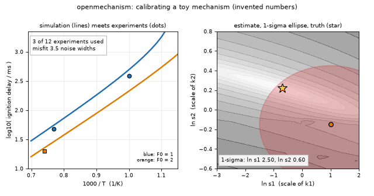
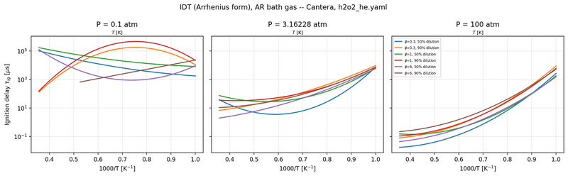
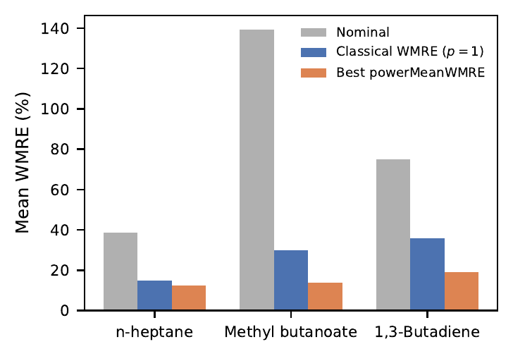
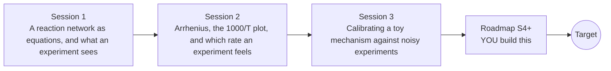

# openmechanism

[](https://github.com/KrunalPanchal1995/openmechanism/actions/workflows/ci.yml)   [](https://colab.research.google.com/github/KrunalPanchal1995/openmechanism/blob/main/sessions/session-01/lesson.ipynb) [](https://krunalpanchal1995.github.io/openmechanism/)

**Tune a kinetic mechanism until its simulations match experiments, in three sessions.**

openmechanism teaches how a reaction mechanism is calibrated against experiments, from two reactions to a stiff toy mechanism with honest parameter uncertainty, using only Python and a browser.

- **Start from two reactions.** Session 1 needs only school algebra and the exponential function; the mechanism is written as equations and solved by hand-made steps.
- **See the temperature trick.** Session 2 shows why chemists plot log k against 1000/T and which rate an experiment can actually pin down.
- **Know you got it right.** Session 3 checks every result against a formula, a known truth or a hand calculation, and each session ends with a checkpoint that prints PASS or FAIL.
- **Build the missing half.** The repo stops at a two-parameter fit on purpose; the roadmap shows the path to the Target.

[Target](#the-target) · [Who is this for](#who-is-this-for) · [Quick start](#quick-start) · [Sessions](#sessions) · [Roadmap](#roadmap) · [Contribute](#contribute) · [Explainer PDF](docs/explainer.pdf)

> **This repo is incomplete on purpose.** Sessions 1 to 3 are here and fully working. The finished Target below is a preview of what the community can build next. We show you the path, not the code. Sessions 4 and up are yours.

## The Target

Twelve noisy synthetic ignition-delay experiments appear one by one. Two simulated curves (one per starting fuel amount) slide onto the data while a red one-sigma ellipse in the plane of the two calibrated scale factors shrinks around the true values (the gold star). The ellipse stays long and thin: one rate constant is pinned down well, the other only weakly, and the ellipse shows exactly that. Your goal over the coming sessions: build this yourself, then ask which experiment would shrink the ellipse fastest.



*Target: simulated curves converge onto experiments while the uncertainty ellipse shrinks (toy numbers)*



*Research context: ignition delay against 1000/T for several conditions (output of the author's MOSIAC work)*

- [Research software: a screen recording of ignition-delay sensitivity analysis in MOSIAC Studio (video)](promo/media/idt_sensitivity_walkthrough.mp4)



*Research context: a power-mean objective against a classical objective when calibrating against several datasets*

Try it live:

- [Math Visual Studio: numerical ODE solvers and stability (Atlas S32)](https://krunalpanchal1995.github.io/studio/#atlas?ch=S32&ex=1)
- [Math Visual Studio: optimisation and the gradient (Atlas S13)](https://krunalpanchal1995.github.io/studio/#atlas?ch=S13&ex=1)
- [Math Visual Studio: uncertainty quantification (Atlas S27)](https://krunalpanchal1995.github.io/studio/#atlas?ch=S27&ex=1)

How the Target was made is shown only as a path in [promo/roadmap.md](promo/roadmap.md).

## Who is this for
**secondary school to diploma / undergraduate (levels 3-5).** Topic area: Chemistry and Materials Science.

Prerequisites:

- School algebra, the exponential function and the natural logarithm.
- Python 3.10 or newer; if `python --version` works, you are ready. PRIMER.md explains the rest.
- No chemistry degree, GitHub, calculus or optimisation experience is needed; every symbol is explained.

New to Python? Read [PRIMER.md](PRIMER.md) first (10 minutes).

## Quick start

No installation knowledge needed. You need [Git](https://git-scm.com/downloads) and [Python 3.10+](https://www.python.org/downloads/) (Windows: tick "Add Python to PATH"). On Mac and Linux type `python3` wherever this page says `python`.

```bash
git clone https://github.com/KrunalPanchal1995/openmechanism.git
cd openmechanism
python start.py 1
```

`start.py` creates a private environment, installs what is needed and runs Session 1 with its checkpoint. Next: `python start.py 2`, `python start.py 3`, or `python start.py test` to check everything. Only a checkpoint: `python start.py check 1`.

A few lines turn the idea of Session 1 into a result (they work as they are): Save it as `try.py` and run it with `python start.py run try.py` (this uses the private environment, where NumPy is installed):

```python
import numpy as np
k1, k2 = 0.5, 1.5                                   # toy rate constants, 1/s: A -> B -> C
t = np.log(k2 / k1) / (k2 - k1)                      # time at which B is largest
B = k1 / (k2 - k1) * (np.exp(-k1 * t) - np.exp(-k2 * t))
print(round(t, 3), round(B, 3))                      # -> 1.099 0.192  (seconds, mol/L)
```

Every session also opens in your browser with sliders (no install): [live apps](https://krunalpanchal1995.github.io/openmechanism/). Or use the Colab badge above for the notebook.

## Sessions

| # | Session | Model level | Time | Live app |
|---|---|---|---|---|
| 1 | [A reaction network as equations, and what an experiment sees](sessions/session-01/README.md) | Level 1: conceptual interactive model | 60 min | [open](https://krunalpanchal1995.github.io/openmechanism/session-01/) |
| 2 | [Arrhenius, the 1000/T plot, and which rate an experiment feels](sessions/session-02/README.md) | Level 2: mathematical engineering model | 75 min | [open](https://krunalpanchal1995.github.io/openmechanism/session-02/) |
| 3 | [Calibrating a toy mechanism against noisy experiments](sessions/session-03/README.md) | Level 3: simulation and validation | 90 min | [open](https://krunalpanchal1995.github.io/openmechanism/session-03/) |

Each session follows the same six steps: A real-world problem, B concept and theory, C visual explanation, D interactive simulation, E worked example and experiment, F assessment and design challenge. Each ends with `checkpoint.py`, which prints `PASS` or `FAIL` against reference numbers. Session 3 also contains the real-world mini-project: **Calibrate two rate constants from a synthetic ignition-delay data set**.

## Architecture



| Folder or file | What is inside |
|---|---|
| `sessions/` | three sessions: README (A-F), `lesson.py`, notebook, live app, exercises, activity sheet, checkpoint |
| `promo/` | the Target: media, live links, and the roadmap (path only) |
| `docs/` | `explainer.tex` and the built `explainer.pdf` |
| `tests/` | runs every lesson and checkpoint headless |
| `start.py` | one command to set up and run anything |
| `QUALITY.md`, `RUBRIC.md` | the quality checklist and the scoring rubric |
| `.github/` | CI, PDF build, Pages deploy, issue and PR templates |

## Roadmap

| Milestone | What you will build | Difficulty |
|---|---|---|
| Session 4: Choose experiments well | A small design tool that, for a budget of 12 experiments, picks conditions that minimise the one-sigma uncertainty of both scale factors. | intermediate |
| Session 5: Fit an activation energy too | A calibration with a parameter that shifts Ea of k2, plus its uncertainty. | intermediate |
| Session 6: Survive a biased dataset | A calibration in which one dataset carries an unknown offset, handled by an extra fitted offset or a robust objective. | advanced |
| Session 7: Propagate the uncertainty into predictions | Sampling parameter sets from the ellipse and simulating the ignition delay at a new temperature. | advanced |
| Session 8: Reproduce the Target | An animation of the curves converging onto the data while the ellipse shrinks. | advanced |

Full detail with a checkpoint per milestone: [promo/roadmap.md](promo/roadmap.md).

## Contribute
New to GitHub? Read [CONTRIBUTING.md](CONTRIBUTING.md); it starts from zero. Pick an issue labelled `good first issue`. Translations into Hindi, Telugu, Tamil and Malayalam are welcome.

<details>
<summary>Development</summary>

```bash
python start.py test        # runs every lesson and checkpoint
```
Lessons use `# %%` cell markers so they open as notebooks in VS Code. See [QUALITY.md](QUALITY.md) for the standard every session meets.
</details>

## License
MIT. See [LICENSE](LICENSE). Media in `promo/media` is (c) Krunal Panchal, CC BY 4.0.

## Acknowledgments
Part of the [PAN IIT OSS](https://hellofoss.tech-iitb.org/projects) open-source teaching collection, modelled on the structure of [openspline](https://github.com/openspline/openspline). Built on ideas from the Math Visual Studio at https://krunalpanchal1995.github.io/studio/.
