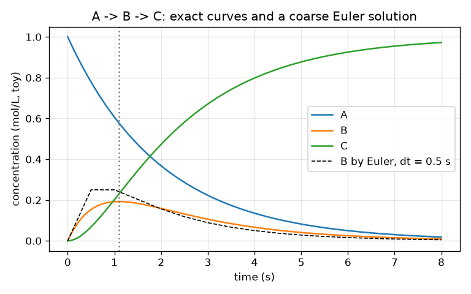
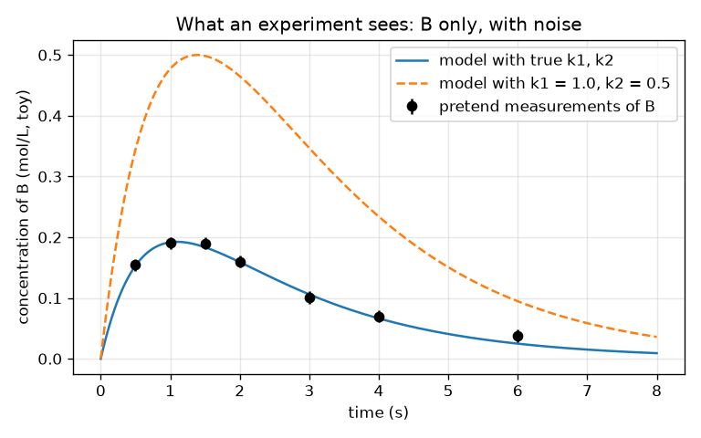

# Session 1: A reaction network as equations, and what an experiment sees

*Level 1 (conceptual interactive model) · about 60 minutes · openmechanism*

> This is a simplified educational model. It is not a validated design tool and must not be used for real structures, electrical installations, vehicles, industrial processes or medical decisions.

**Prerequisites**

- School algebra and the exponential function exp(x).
- You have read PRIMER.md and run `python start.py 1` once.

**Learning objectives.** After this session you can:

- Write a two-step reaction network A -> B -> C as three rate equations.
- Solve the equations with small time steps (Euler's method) and compare with the exact formula.
- Explain why the intermediate B rises, peaks and falls, and find when it peaks.
- Describe what an experiment measures and how noise limits what it can tell you.

## A. Real-world problem
Burning a fuel is never one step: molecules turn into other molecules, which turn into others. A list of such steps, each with a speed, is called a mechanism, and real ones have hundreds of steps. An experiment cannot watch every molecule; it measures one thing, such as how much of an intermediate is present at a few moments. Can we build the smallest possible mechanism, two steps, write it as equations, and see what a measurement of the middle molecule B can reveal about the two speeds? (Toy numbers throughout; this is a teaching model, not real chemistry data.)

## B. Concept and theory
A rate constant k tells how fast a reaction proceeds: in A -> B the amount of A drops at the speed k1 times the amount of A. For A -> B -> C we get three linked equations: A only decays, B is fed by A and drained into C, and C only grows. The total A + B + C stays constant because molecules are not lost. For k1 different from k2 the exact solution is a difference of two exponentials. B starts at zero, rises while A is plentiful, and falls once it drains faster than it is fed; it peaks exactly when the feed k1 A equals the drain k2 B. Euler's method replaces the smooth change by small jumps of size (rate x time step), and gets better as the step shrinks. An experiment gives noisy numbers at a few times, so many pairs (k1, k2) can look nearly right; the misfit (root-mean-square difference) tells how far a model is from the data.

| Symbol | Meaning | Unit |
|---|---|---|
| A, B, C | concentrations of the three molecules | mol/L (toy) |
| t | time | s |
| k1, k2 | rate constants of A -> B and B -> C | 1/s |
| dt | Euler time step | s |
| t* | time at which B is largest | s |

**Assumptions**

- Both reactions are first order: the speed is proportional to the amount of the molecule that reacts.
- Start with A = 1 mol/L, B = C = 0; the temperature is constant.
- The numbers are invented for teaching and are not data for any real reaction.

$$ \frac{dA}{dt}=-k_1A,\qquad \frac{dB}{dt}=k_1A-k_2B,\qquad \frac{dC}{dt}=k_2B $$

$$ A(t)=e^{-k_1t},\qquad B(t)=\frac{k_1}{k_2-k_1}\left(e^{-k_1t}-e^{-k_2t}\right),\qquad C=1-A-B $$

$$ t^{*}=\frac{\ln(k_2/k_1)}{k_2-k_1},\qquad B_{\max}=\left(\frac{k_1}{k_2}\right)^{k_2/(k_2-k_1)} $$

$$ y_{n+1}=y_n+\Delta t\,f(y_n)\quad\text{(Euler step)} $$

## C. Visual explanation
The first figure shows A falling, B rising to a single peak and then falling, and C rising to 1, with the coarse Euler solution (dashed) drifting visibly from the exact curve. The second figure shows what an experiment sees: only B, at seven times, with error bars, together with two model curves. The curve with the true rate constants passes through the points; a curve with k1 = 1.0 and k2 = 0.5 lies far above them.

*A, B and C against time for k1 = 0.5 and k2 = 1.5 per s, with a coarse Euler solution (dashed).*

*What an experiment sees: noisy measurements of B only, and two model curves.*

## D. Interactive simulation
Run the lesson (`python start.py 1`), then open the live app: [Session 1: A -> B -> C](https://krunalpanchal1995.github.io/openmechanism/session-01/) (or `app.html` in this folder). Move the k1 and k2 sliders and watch the tanks and the curves. Find what makes B peak earlier or later and higher or lower, and use the time slider to read the tank levels.

**Challenge.** Make B peak at about 2 s (between 1.9 and 2.1 s).

## E. Worked example and experiment
**Problem.** With k1 = 0.5 per s and k2 = 1.5 per s, when does B peak, how large is B then, and what is B at t = 1 s?

1. Peak time: t* = ln(k2/k1) / (k2 - k1) = ln 3 / 1.0 = 1.0986 s.
2. Peak height: B = (k1/k2)^(k2/(k2-k1)) = (1/3)^1.5 = 0.1925 mol/L.
3. Check at the peak: A = exp(-0.5 x 1.0986) = 0.577, so feed k1 A = 0.289 and drain k2 B = 1.5 x 0.1925 = 0.289. They are equal, as they must be at a maximum.
4. At t = 1 s: B = 0.5 / 1.0 x (exp(-0.5) - exp(-1.5)) = 0.5 x (0.6065 - 0.2231) = 0.1917 mol/L, just below the peak, as expected.

**Answer.** B peaks at 1.099 s with 0.1925 mol/L; at 1 s it is 0.1917 mol/L.

**Experiment.** Mimic it with a leaking-bucket model: pour water into a top bucket that drains through a hole into a second bucket that also has a hole, and time the level of the second bucket with a ruler. It rises, peaks and falls, as B does. The model differs from reality because real draining depends on the water level in a more complicated way than 'proportional to the level', and because reading a ruler adds noise: the equations are exact for the model, not for the buckets.

## F. Assessment and design challenge
**Question type A: Conceptual.** Why does B rise first and then fall, even though both reactions run all the time? At which moment is its rate of change zero?

Hint

Compare how fast B is fed with how fast it drains.

Step-by-step solution

B is fed at k1 A, which is large at the start (A is plentiful) and shrinks as A is used up; B is drained at k2 B, which is zero at the start and grows with B. Early on the feed wins and B rises; later the drain wins and B falls. The rate of change of B is zero exactly when feed equals drain, k1 A = k2 B, which is the peak.

**Question type B: Numerical.** For k1 = 0.4 per s and k2 = 0.8 per s, find the time and height of the peak of B. Check the units and that the answer is sensible.

Hint

Use t* = ln(k2/k1)/(k2 - k1) and B_max = (k1/k2)^(k2/(k2-k1)).

Step-by-step solution

t* = ln 2 / 0.4 = 0.6931 / 0.4 = 1.733 s. B_max = (0.5)^(0.8/0.4) = 0.5^2 = 0.25 mol/L. Units: ln of a ratio has no unit, divided by 1/s gives s; B is a fraction of the starting 1 mol/L, so 0.25 mol/L is plausible (less than 1). Check with the full formula: B(1.733) = 0.4/0.4 x (exp(-0.693) - exp(-1.386)) = 0.5 - 0.25 = 0.25.

**Question type C: Graph and simulation interpretation.** In the concentration graph with k1 = 0.5 and k2 = 1.5, which curve rises fastest at the moment B is at its peak, and why?

Hint

C grows at the speed k2 B.

Step-by-step solution

C grows at k2 B. B is largest at its peak, so the growth rate of C is largest there: the C curve is steepest at 1.1 s. The A curve is falling all the time and is steepest at t = 0.

**Question type D: Design and optimisation challenge.** Design: you may measure B at one time only. The unknown mechanism is either (k1, k2) = (0.5, 1.5) or (1.5, 0.5), and the measurement noise is 0.01 mol/L. Which time do you choose, and how well will you tell the two apart?

Hint

Compute B(t) for both and look at the difference. A useful fact: swapping k1 and k2 changes B by a constant factor.

Step-by-step solution

Swapping the two rate constants multiplies B by k2/k1 = 3 at every time, so the second mechanism always gives 3 times as much B. The difference is largest where B is largest, at the common peak time 1.099 s: 0.1925 against 0.577 mol/L, a difference of 0.385 mol/L, about 38 times the noise. Any time works in principle, but the peak gives the largest margin. Trade-off: a measurement at t = 0 (B = 0) tells nothing, and very late times give tiny signals close to the noise.

Score yourself with [RUBRIC.md](../../RUBRIC.md). Print the [activity sheet](activity_sheet.md) to work on paper.

## Common misconceptions
| Common misconception | What is actually true |
|---|---|
| The intermediate B just keeps rising until A is gone. | B is fed and drained at the same time; it peaks when feed equals drain and then falls. |
| Doubling both rate constants doubles B. | Doubling both speeds the whole process up (the peak comes at half the time); B(t) changes shape and the peak height stays the same, because only the ratio k1/k2 sets the height. |
| A smaller Euler step always makes the answer exact. | It makes it better, not exact: the error shrinks roughly in proportion to the step, and a computer with tiny steps takes longer. |
| If the model passes through the data, the rate constants are certainly right. | Noisy data allow a range of rate constants; the misfit shows how far you are, not whether the answer is unique. |

## Glossary
- **mechanism**: a list of reactions with their rate constants
- **rate constant**: the number k that sets how fast a reaction runs; here in 1/s
- **intermediate**: a molecule that is made and then used up, like B
- **Euler's method**: solving an equation by repeating small steps of (rate x time step)
- **misfit**: root-mean-square difference between model and measurements

## Finish
1. Do the three coding tasks in [exercises.md](exercises.md).
2. Run `python start.py 1` again after your changes. It ends with the checkpoint; when it prints `PASS`, you are done. (Checkpoint only: `python start.py check 1`.)

Next: [Session 2](../session-02/README.md)
