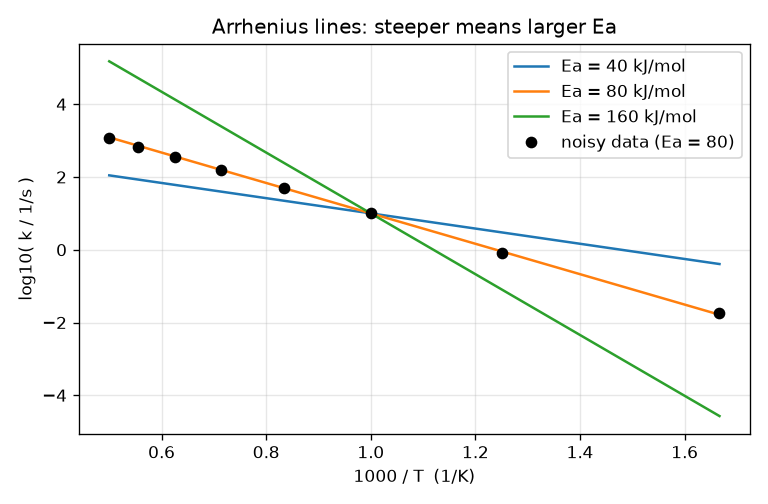
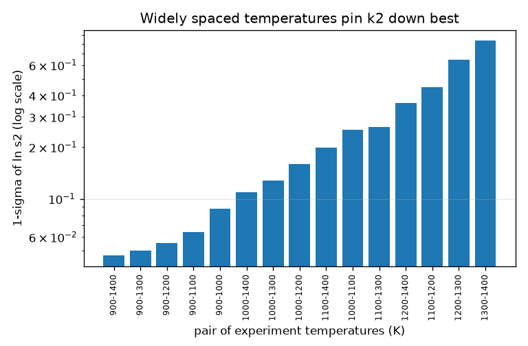
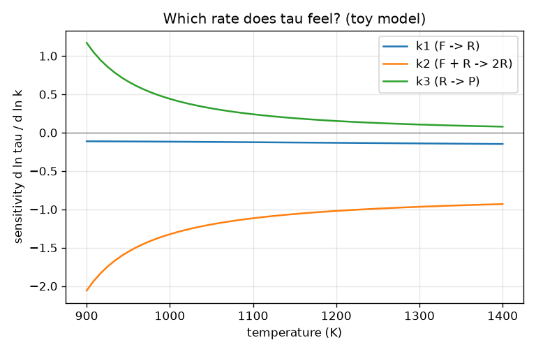

# Session 2: Arrhenius, the 1000/T plot, and which rate an experiment feels

*Level 2 (mathematical engineering model) · about 75 minutes · openmechanism*

> This is a simplified educational model. It is not a validated design tool and must not be used for real structures, electrical installations, vehicles, industrial processes or medical decisions.

**Prerequisites**

- Session 1: rate constants and rate equations.
- Logarithms: ln(a b) = ln a + ln b and ln(e^x) = x.

**Learning objectives.** After this session you can:

- Use the Arrhenius form k = A T^n exp(-Ea / R T) and state the unit of each symbol.
- Explain why log k plotted against 1000/T is a straight line whose slope gives Ea.
- Compute the sensitivity d ln(tau) / d ln(k) of an experiment output to each rate constant by finite differences, and check it against calculus.
- Solve a design problem: choose experiment temperatures that pin down the most uncertain rate constants.

## A. Real-world problem
Hot gas reacts much faster than cold gas: raising the temperature from 1000 K to 1200 K can speed a reaction up fivefold. A mechanism therefore stores a formula for every rate constant, and calibration adjusts that formula. But which of the hundreds of rate constants does a given experiment actually care about? If we nudge one by 1 percent, how much does the measured ignition delay move? And if we can afford only two experiments, at which temperatures should we run them? (Toy numbers; not data for any real fuel.)

## B. Concept and theory
The modified Arrhenius form says k(T) = A T^n exp(-Ea / R T). The exponential is the fraction of molecular encounters that carry at least the activation energy Ea; R = 8.314 J/(mol K) converts temperature into energy per mole. Taking logarithms gives ln k = ln A + n ln T - Ea / (R T), a straight line in 1/T when n = 0; plotting against 1000/T keeps the numbers near 1, and the slope is -Ea/(1000 R) per unit of 1000/T, so a line fitted through measured rate constants gives Ea. For the toy ignition delay we use a branching chain F -> R (k1), F + R -> 2 R (k2), R -> P (k3). While fuel is plentiful the radical R grows at the rate g = k2 F0 - k3 and is seeded by k1, so the radical amount reaches F0/2 after tau = ln(1 + g / (2 k1)) / g (an approximation that ignores fuel use). The sensitivity S_i = d ln tau / d ln k_i is the percent change of tau per percent change of k_i; we compute it by a central difference and verify it against the derivative. Each experiment adds a row of sensitivities to a matrix J; with noise sigma, the uncertainty of the scale factors of the rate constants is the square root of the diagonal of (J^T J)^-1.

| Symbol | Meaning | Unit |
|---|---|---|
| k | rate constant | 1/s (first order) |
| A | pre-exponential factor, carries the unit of k | 1/s (for n = 0) |
| n | temperature exponent | no unit |
| Ea | activation energy | J/mol (kJ/mol in the app) |
| R | gas constant, 8.314 J/(mol K) | J/(mol K) |
| T | absolute temperature | K |
| tau | ignition delay | s |
| S_i | sensitivity d ln tau / d ln k_i | no unit |
| sigma | noise in ln tau (0.05 = 5 percent) | no unit |

**Assumptions**

- The Arrhenius form is an empirical fit; real rate constants can curve on the 1000/T plot (that is what n is for).
- The toy ignition-delay formula assumes the fuel is barely used while the radicals grow; Session 3 measures its error.
- Noise is independent and the same for every experiment; the model is linear for small changes.

$$ k(T)=A\,T^{n}\exp\!\left(-\frac{E_a}{R\,T}\right) $$

$$ \ln k=\ln A+n\ln T-\frac{E_a}{R}\cdot\frac{1}{T},\qquad \text{slope on a }\frac{1000}{T}\text{ plot}=-\frac{E_a}{1000\,R} $$

$$ g=k_2F_0-k_3,\qquad \tau=\frac{1}{g}\ln\!\left(1+\frac{g}{2k_1}\right) $$

$$ S_i=\frac{\partial\ln\tau}{\partial\ln k_i}\approx\frac{\ln\tau(k_ie^{\varepsilon})-\ln\tau(k_ie^{-\varepsilon})}{2\varepsilon} $$

$$ \mathrm{Cov}=(J^{\mathsf T}J)^{-1},\qquad J_{ij}=\frac{S_{ij}}{\sigma} $$

## C. Visual explanation
The first figure shows Arrhenius lines on the 1000/T plot for three activation energies: each is straight and the larger Ea gives the steeper line; noisy data points scatter around the 80 kJ/mol line. The second plots the sensitivities of the toy ignition delay to k1, k2 and k3 against temperature: k2 dominates (about -2.1 at 900 K and -0.9 at 1400 K), k3 matters at low temperature (+1.2 at 900 K) and fades at high temperature (+0.08 at 1400 K), and k1 hardly matters (about -0.1). The third figure plots, for every pair of two temperatures from six candidates, how well k2 would be determined: the best pair is about 18 times better than the worst pair.

*Arrhenius lines on the 1000/T plot: steeper means larger activation energy.*

*Uncertainty of ln s2 for every pair of two experiment temperatures (log scale): wide spacing wins.*

*Sensitivity of the toy ignition delay to k1, k2 and k3 against temperature.*

## D. Interactive simulation
Run the lesson (`python start.py 2`), then open the live app: [Session 2: Arrhenius and the 1000/T plot](https://krunalpanchal1995.github.io/openmechanism/session-02/) (or `app.html` in this folder). Change Ea, n and the reference rate constant and watch the straight line on the 1000/T plot tilt and shift; use the barrier picture to see how the thermal energy R T compares with Ea and how the fraction exp(-Ea/RT) responds to temperature.

**Challenge.** Set the activation energy so that the rate constant at 1000 K is 10 times larger than at 800 K (log10 ratio between 0.95 and 1.05).

## E. Worked example and experiment
**Problem.** A reaction has Ea = 80 kJ/mol and n = 0. By what factor does k increase from 1000 K to 1200 K? Then find the toy ignition delay at 1000 K from the formula.

1. Ratio = exp(Ea / R x (1/1000 - 1/1200)) = exp(80000 / 8.3145 x 1.6667e-4).
2. 80000 / 8.3145 = 9621.8; times 1.6667e-4 = 1.6036; exp(1.6036) = 4.97. Units: Ea / (R T) is dimensionless, so the ratio is a pure number.
3. Toy ignition delay at 1000 K: k1 = 0.002 per s, k2 = 30 L/(mol s), k3 = 10 per s, F0 = 1 mol/L, so g = 30 x 1 - 10 = 20 per s.
4. tau = ln(1 + 20 / (2 x 0.002)) / 20 = ln(5001) / 20 = 8.517 / 20 = 0.4259 s.

**Answer.** The rate constant grows by a factor of 4.97, and the toy ignition delay at 1000 K is 0.4259 s.

**Experiment.** Compare with a measured rate constant: real data of k at several temperatures are usually plotted as log k against 1000/T. Fit a straight line and read Ea from the slope; the fit always has scatter, and a real curve may bend, which the single-Ea form cannot reproduce. The toy formula for tau differs from a real ignition delay because it has three reactions and a made-up set of numbers; its value is in the trends (hotter is faster; k2 is most important), not in the numbers.

## F. Assessment and design challenge
**Question type A: Conceptual.** Why is a plot of log k against 1000/T a straight line for the simple Arrhenius form, and what physical quantity does its slope give?

Hint

Take the logarithm of k = A exp(-Ea / R T) and compare with y = c + m x.

Step-by-step solution

ln k = ln A - (Ea / R) (1/T) has the form c + m x with x = 1/T, so it is a straight line. The slope is -Ea/R per unit of 1/T, or -Ea/(1000 R) per unit of 1000/T. A steeper line therefore means a larger activation energy: a reaction that is more sensitive to temperature.

**Question type B: Numerical.** A reaction has Ea = 120 kJ/mol (n = 0). Find the factor by which k grows from 1000 K to 1100 K, and the slope of ln k against 1000/T.

Hint

Ratio = exp(Ea/R x (1/1000 - 1/1100)). Slope = -Ea/(1000 R).

Step-by-step solution

Ea/R = 120000 / 8.3145 = 14433 K. (1/1000 - 1/1100) = 9.091e-5 per K. Product = 1.312, exp(1.312) = 3.71. The slope is -14433 / 1000 = -14.43 per unit of 1000/T (in log10: -6.27). Sanity check: a larger Ea than the worked example (80) with a smaller temperature range (100 K instead of 200 K) gives a similar order, 3.7 versus 5.0.

**Question type C: Graph and simulation interpretation.** Look at the sensitivity graph. Which rate constant does the ignition delay feel most at 900 K, and at 1400 K? What does a negative or a positive sign mean?

Hint

Compare the absolute values of the three curves at each temperature.

Step-by-step solution

At 900 K the magnitudes are about 2.06 (k2), 1.17 (k3) and 0.11 (k1): k2 dominates, k3 is also important. At 1400 K they are 0.93 (k2), 0.08 (k3) and 0.15 (k1): k2 again dominates, k3 is nearly irrelevant. A negative sign (k1, k2) means a faster reaction shortens the delay; the positive sign of k3 means a faster radical loss lengthens it.

**Question type D: Design and optimisation challenge.** Design: you can run two experiments at two of the temperatures 900, 1000, 1100, 1200, 1300, 1400 K (5 percent noise) to learn the scale factors of k1 and k2. Which pair do you choose, which pair is worst, and why?

Hint

Use `design_std(pair)` for all 15 pairs and compare the first column (ln s1) and second column (ln s2).

Step-by-step solution

The widest pair, 900 and 1400 K, is best: one-sigma uncertainties of (ln s1, ln s2) = (0.57, 0.047). The two hottest, 1300 and 1400 K, are worst: (5.5, 0.83): the sensitivity rows are almost parallel, so the two unknowns cannot be separated. Reason: k1 and k2 have different activation energies, so their effects differ most when the temperatures are far apart. Trade-offs: the coldest experiment is slowest and may be hard to run; and the toy formula ignores the fuel being used up, so check a candidate design with the full solver of Session 3 before relying on it.

Score yourself with [RUBRIC.md](../../RUBRIC.md). Print the [activity sheet](activity_sheet.md) to work on paper.

## Common misconceptions
| Common misconception | What is actually true |
|---|---|
| Doubling the temperature doubles the rate constant. | k depends on T through exp(-Ea / R T): a 20 percent rise from 1000 K to 1200 K already multiplies k by about 5 for Ea = 80 kJ/mol. |
| A large sensitivity means the rate constant is large. | Sensitivity measures how strongly the output responds to a percentage change of k, not the size of k. In the toy model k1 is tiny and has a small sensitivity, but a big sensitivity can belong to any rate. |
| More experiments at similar conditions always help equally. | Experiments at nearly the same temperature give nearly the same sensitivity rows, so they add little new information about separate rate constants. |
| The Arrhenius plot must be a perfectly straight line. | Only for n = 0. With n different from zero (or for some real reactions) the line curves slightly. |

## Glossary
- **activation energy**: the energy barrier Ea that molecules must overcome, in J/mol
- **pre-exponential factor**: the A in k = A T^n exp(-Ea/RT); carries the unit of k
- **ignition delay**: the time from the start until the reaction runs away; here the time for the radical to reach half the fuel amount
- **sensitivity**: percent change of an output per percent change of a rate constant
- **finite difference**: estimating a derivative from two nearby function values
- **Jacobian**: the matrix of sensitivities of every output to every parameter

## Finish
1. Do the three coding tasks in [exercises.md](exercises.md).
2. Run `python start.py 2` again after your changes. It ends with the checkpoint; when it prints `PASS`, you are done. (Checkpoint only: `python start.py check 2`.)

Next: [Session 3](../session-03/README.md)
