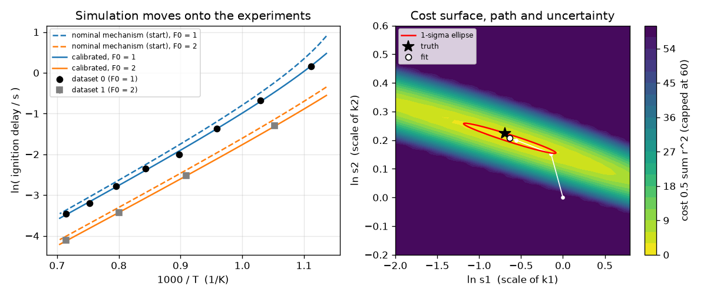
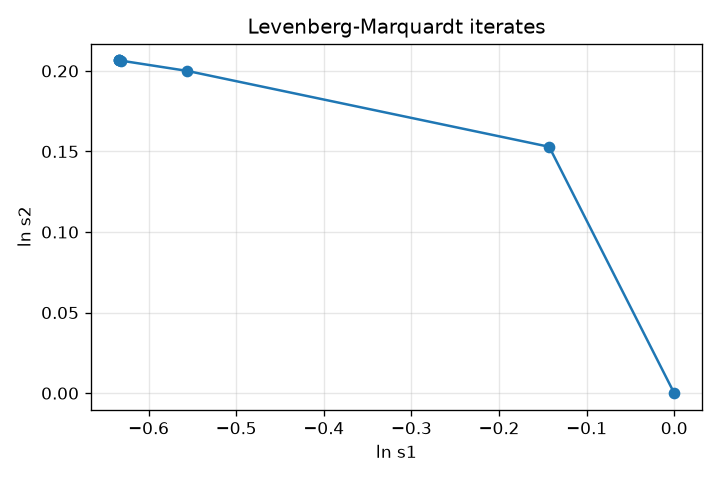

# Session 3: Calibrating a toy mechanism against noisy experiments

*Level 3 (simulation and validation) · about 90 minutes · openmechanism*

> This is a simplified educational model. It is not a validated design tool and must not be used for real structures, electrical installations, vehicles, industrial processes or medical decisions.

**Prerequisites**

- Session 1: rate equations and Euler's method.
- Session 2: Arrhenius form and sensitivities.
- Comfort with a column of numbers as a vector; matrices are explained in Section B.

**Learning objectives.** After this session you can:

- Write an implicit (trapezoidal) ODE solver for a stiff toy mechanism and validate it against a formula and by halving the step.
- Calibrate two rate-constant scale factors from noisy synthetic ignition delays by Levenberg-Marquardt least squares.
- Read parameter uncertainty and correlation from the Jacobian, and check that the fit recovers a known truth.
- Test how the fit responds to noise level, starting guess and a systematic error, and explain the power-mean objective.

## A. Real-world problem
A kinetic mechanism has rate constants that nobody knows exactly. Experiments, here ignition delays at several temperatures, measure what the mechanism should predict. Calibration moves the rate constants until the simulations match, and it must also say how well the data pinned each one down. Can we write the solver, generate fake experiments from a known truth, recover that truth by least squares, and see honestly which parameters the data cannot determine? (Everything is a toy: four invented reactions and invented numbers, far simpler than real combustion chemistry, and not usable for engineering decisions.)

## B. Concept and theory
The toy mechanism is F -> R (k1), F + R -> 2R (k2), R -> P (k3), F -> P (k4), solved as two coupled ODEs for fuel F and radical R. Rates differ by large factors, which makes real mechanisms stiff: explicit methods need tiny steps. We use the trapezoidal rule, which solves for the new state at each step with Newton's method, is second-order accurate and stays bounded for large steps. Ignition delay tau is the time when F reaches F0/2. We calibrate theta = (ln s1, ln s2), the logarithms of scale factors multiplying k1 and k2 at all temperatures. For each experiment the residual is r_i = (ln tau_model - ln tau_observed) / sigma_i. Levenberg-Marquardt steps by delta = -(J^T J + lambda D)^-1 J^T r with J the Jacobian of the residuals (by finite differences). At the optimum the covariance of the estimates is (J^T J)^-1, which gives one-sigma uncertainties and an ellipse; the reduced chi-square sum(r^2)/(n - 2) should be near 1. With several datasets, the power-mean objective M_p = (mean over datasets of E_d^p)^(1/p) with E_d the root-mean-square residual of dataset d is minimised by re-weighting each dataset by E_d^(p-2)/n_d: p = 2 gives every dataset the same total weight however many points it has. Because the data are synthetic, we can compare the answer with the truth, which is impossible for real experiments.

| Symbol | Meaning | Unit |
|---|---|---|
| F, R, P | fuel, radical, product concentrations | mol/L (toy) |
| k1..k4 | rate constants (k2 in L/(mol s), others in 1/s) | see text |
| s | scale factor on a rate constant (1 = nominal) | no unit |
| theta | parameters (ln s1, ln s2) | no unit |
| tau | ignition delay: F = F0/2 | s |
| sigma | noise in ln tau (0.05) | no unit |
| r | residual in units of noise widths | no unit |
| J | Jacobian of the residuals | per unit of theta |
| Cov | covariance of the estimated theta | no unit |

**Assumptions**

- All four rate constants follow the Arrhenius form with invented numbers; only k1 and k2 are calibrated and k3, k4 are known.
- Noise is independent, Gaussian and 5 percent in ln tau; the model is correct (except in the deliberate bias test).
- The covariance formula is a linear approximation: it is good near the optimum and misleading for strongly nonlinear problems or on the boundary of ignition.
- A toy: do not use it for any real mechanism or design decision.

$$ \frac{dF}{dt}=-(k_1+k_4)F-k_2FR,\qquad \frac{dR}{dt}=k_1F+k_2FR-k_3R $$

$$ y_{n+1}=y_n+\tfrac{\Delta t}{2}\big(f(y_n)+f(y_{n+1})\big)\quad\text{(trapezoidal rule, solved by Newton)} $$

$$ r_i=\frac{\ln\tau_i^{\mathrm{model}}(\theta)-\ln\tau_i^{\mathrm{obs}}}{\sigma_i},\qquad \theta=(\ln s_1,\ln s_2) $$

$$ \delta=-\big(J^{\mathsf T}J+\lambda D\big)^{-1}J^{\mathsf T}r,\qquad \mathrm{Cov}=(J^{\mathsf T}J)^{-1} $$

$$ M_p=\Big(\tfrac1D\sum_{d}E_d^{\,p}\Big)^{1/p},\qquad E_d=\sqrt{\tfrac1{n_d}\sum_{i\in d}r_i^2} $$

## C. Visual explanation
The left panel shows the data on a ln tau against 1000/T plot with the nominal-mechanism curves dashed and the calibrated curves solid sitting on the points. The right panel is the cost surface in (ln s1, ln s2): a long, narrow, tilted valley. The Levenberg-Marquardt path runs into it in a few iterations and ends inside the red one-sigma ellipse, which contains the truth (star). The ellipse is long in the ln s1 direction and thin in ln s2: the data fix k2 well and k1 poorly, and the two are strongly anti-correlated (correlation about -0.97).

*Left: data, nominal (dashed) and calibrated (solid) curves. Right: cost surface, fit path, one-sigma ellipse and truth.*

*Levenberg-Marquardt iterates in the plane of ln s1 and ln s2.*

## D. Interactive simulation
Run the lesson (`python start.py 3`), then open the live app: [Session 3: fit the toy mechanism by hand](https://krunalpanchal1995.github.io/openmechanism/session-03/) (or `app.html` in this folder). Move the two sliders and watch the model curves, the residuals and the cost map. Use the cost map as a landscape: find the valley, then use the residual view to see which experiments are not matched.

**Challenge.** Put the point in the valley of the cost map: ln s1 within 0.15 of -0.65 and ln s2 within 0.03 of 0.21.

## E. Worked example and experiment
**Problem.** Calibrate from the nominal mechanism (s1 = s2 = 1) using the synthetic data set with seed 1 (truth: s1 = 0.5, s2 = 1.25). Report the fit, its uncertainty, and whether the truth is recovered.

1. Start: theta = (0, 0), cost 0.5 sum r^2 = 72.5. Levenberg-Marquardt reaches theta = (-0.634, 0.207) in about 5 iterations with cost 2.02.
2. Scale factors: s1 = exp(-0.634) = 0.53 and s2 = exp(0.207) = 1.23, compared with the truth 0.50 and 1.25.
3. Uncertainty from (J^T J)^-1: one-sigma of (ln s1, ln s2) = (0.55, 0.053), correlation -0.97. So k2 is known to about 5 percent and k1 only to a factor of about e^0.55 = 1.7.
4. z-scores = (fit - truth) / sigma: (-0.634 + 0.693) / 0.551 = 0.11 and (0.207 - 0.223) / 0.053 = -0.3. Both are well inside 2 sigma, so the truth is recovered within its uncertainty. The reduced chi-square is 0.40 with 10 degrees of freedom, consistent with noise-only residuals for one noise draw.

**Answer.** The fit gives s1 = 0.53 and s2 = 1.23 (truth 0.50 and 1.25); the truth lies within 0.11 and 0.3 standard deviations; k2 is well determined (5 percent), k1 is not (a factor of 1.7).

**Experiment.** In a real laboratory you would compare the calibrated mechanism with measurements that were not used in the fit (validation data) and look for systematic trends in the residuals. The synthetic test here is easier than reality in three ways: the model is exactly right, the noise level is known, and the truth is known. Real calibrations must also cope with a model that is wrong in some regime, which no amount of fitting removes; the bias test in the lesson shows how a systematic error in one dataset can shift the poorly determined parameter a lot.

## Real-world application and mini-project: Calibrate two rate constants from a synthetic ignition-delay data set
A lab hands you 12 noisy ignition delays (`make_dataset(seed=42)` from Session 3: 8 temperatures at 1 mol/L fuel and 4 at 2 mol/L, 5 percent noise). The nominal mechanism is wrong: the scale factors of k1 and k2 are unknown. Use `calibrate` from Session 3 to find them, then use `covariance` to report how well each is known and draw the one-sigma ellipse. Because the data are synthetic you may then compare with `TRUTH`, which a real lab never could.

**Deliverable:** A script that prints the fitted scale factors of k1 and k2, their one-sigma uncertainties, their correlation and the reduced chi-square, saves a picture with the data, the nominal and the calibrated curves and a second picture with the ellipse, and states in one sentence which of the two rate constants the data constrain better and why.

**Success looks like:** The fitted scale factor of k2 is between 1.1 and 1.4 (it is about 1.24), the true point lies inside the 2-sigma ellipse, the reduced chi-square is between 0.3 and 3 (it is about 1.0), and the write-up says that k2 is well determined (about 5 percent) while k1 is not (a factor of about 1.7).

## F. Assessment and design challenge
**Question type A: Conceptual.** The fitted ln s1 has a one-sigma uncertainty of 0.55 while ln s2 has 0.053. Explain why the data pin k2 down much better, and why the two uncertainties are strongly correlated.

Hint

Remember the sensitivities of Session 2: tau depends on k1 only through a logarithm.

Step-by-step solution

The ignition delay is tau = ln(1 + g/(2 k1)) / g approximately: it depends on k1 only inside a logarithm (sensitivity about -0.1), but on k2 almost proportionally (sensitivity about -1 to -2). A 5 percent measurement therefore fixes k2 to about 5 percent but k1 only to a large factor. A change of k1 can be partly undone by a small change of k2 (they act on the delay in the same direction through the same quantity g), so the cost surface has a tilted narrow valley and the estimates are anti-correlated (about -0.97).

**Question type B: Numerical.** The calibration used 12 experiments and gave a one-sigma uncertainty of 0.053 for ln s2. If you repeat the whole campaign 4 times (48 experiments, same noise), what uncertainty do you expect? What would 4 times less noise give?

Hint

Cov = (J^T J)^-1, and J^T J adds up over experiments.

Step-by-step solution

Four repeats of every row multiply J^T J by 4, so the covariance is divided by 4 and the standard deviation by 2: 0.053 / 2 = 0.027 (a 2.7 percent uncertainty in k2). With 4 times less noise, J is multiplied by 4 so J^T J by 16 and the standard deviation drops by 4: 0.013. Sanity check: the uncertainty scales linearly with sigma and as one over the square root of the number of equal experiments (the lesson checks the halving numerically). This assumes independent noise and a model that is linear near the optimum.

**Question type C: Graph and simulation interpretation.** In the cost-surface picture, what does the long axis of the valley tell you, and where would the one-sigma ellipse of a set of experiments at 1300 and 1400 K only look different?

Hint

Think of how a parameter combination that does not change the cost relates to the uncertainty.

Step-by-step solution

The long axis is the combination of parameters the data hardly constrain: moving along it changes the cost very little. The ellipse is the contour where the cost rises by a fixed amount, so it is long along that axis. Experiments at similar temperatures give almost parallel Jacobian rows (Session 2), so the valley becomes even longer and thinner: the ellipse stretches further and in the limit becomes a line.

**Question type D: Design and optimisation challenge.** Design: you have 12 experiments to spend, all with 1 mol/L fuel, and the temperature may be 900 to 1400 K. Compare the shipped design (8 temperatures plus 4 at 2 mol/L) with putting 6 experiments at 900 K and 6 at 1400 K. Which gives the smaller uncertainty of ln s1, and what could go wrong?

Hint

Build a data set dictionary like `make_dataset` produces and call `covariance(TRUTH, data)`.

Step-by-step solution

Shipped design: one-sigma of ln s1 about 0.57 at the truth. 6 experiments each at 900 and 1400 K: 0.35. Widely separated temperatures give very different sensitivity rows and pin both parameters better. Risks: (i) the coldest experiment must really be run, and at 900 K with only 0.5 mol/L fuel the toy mechanism does not ignite at all, so conditions must be checked with the solver first; (ii) putting all experiments at two temperatures leaves no way to detect that the model is wrong between them; (iii) the covariance is a linear estimate. A design with a few points in the middle trades some uncertainty for robustness.

Score yourself with [RUBRIC.md](../../RUBRIC.md). Print the [activity sheet](activity_sheet.md) to work on paper.

## Common misconceptions
| Common misconception | What is actually true |
|---|---|
| A good fit means all parameters are well determined. | A fit can be excellent while a parameter is almost free: here ln s1 has an uncertainty of 0.55 and the fit still has chi-square near 1. Always report the uncertainty. |
| Reduced chi-square close to 1 proves the model is right. | It says the residuals are consistent with the stated noise; a wrong model with a larger noise estimate can give the same value. |
| Implicit methods are more accurate than explicit ones. | They are more stable for stiff problems, not necessarily more accurate; accuracy comes from the order of the method and the step size, which is why we also check by halving the step. |
| A better objective function removes a systematic error in one dataset. | No objective can tell a biased dataset from a wrong parameter. A power mean only changes how much each dataset counts; it does not reveal the bias. |

## Glossary
- **stiff**: an ODE with very different time scales, where explicit methods need tiny steps for stability
- **implicit method**: a method in which the new state appears on both sides of the update formula, so each step is solved (here by Newton's method)
- **residual**: (model - observation) / noise: how many noise widths the model is off
- **Jacobian**: the matrix of slopes of every residual with respect to every parameter
- **covariance**: the matrix whose diagonal holds the squared uncertainties of the estimates and whose off-diagonal terms show how they are tied together
- **Levenberg-Marquardt**: a least-squares method that blends Gauss-Newton and cautious gradient steps
- **power mean**: an average with an exponent p; large p puts more weight on the worst dataset

## Finish
1. Do the three coding tasks in [exercises.md](exercises.md).
2. Run `python start.py 3` again after your changes. It ends with the checkpoint; when it prints `PASS`, you are done. (Checkpoint only: `python start.py check 3`.)

Next: the [roadmap](../../promo/roadmap.md). Session 4 is yours to build.
